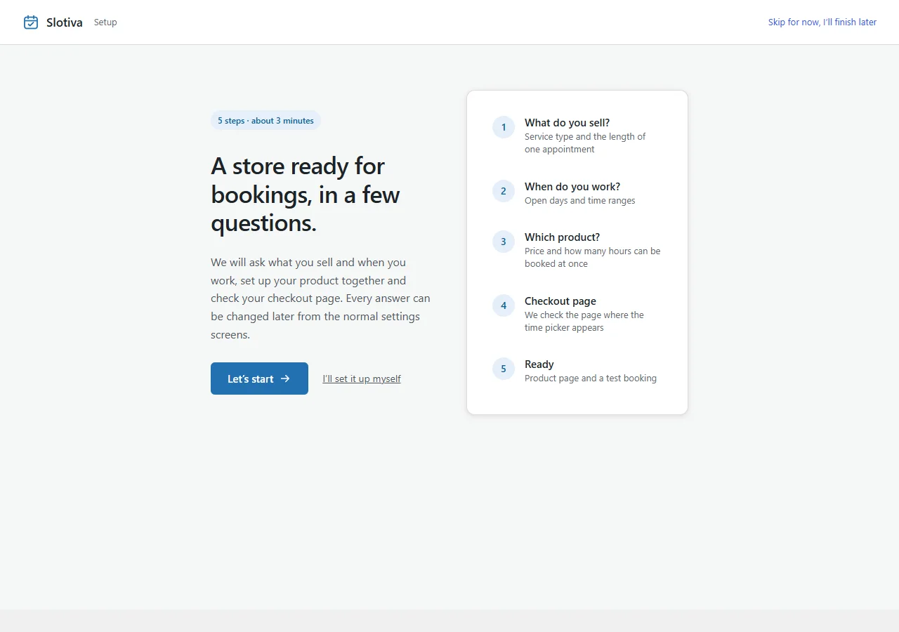
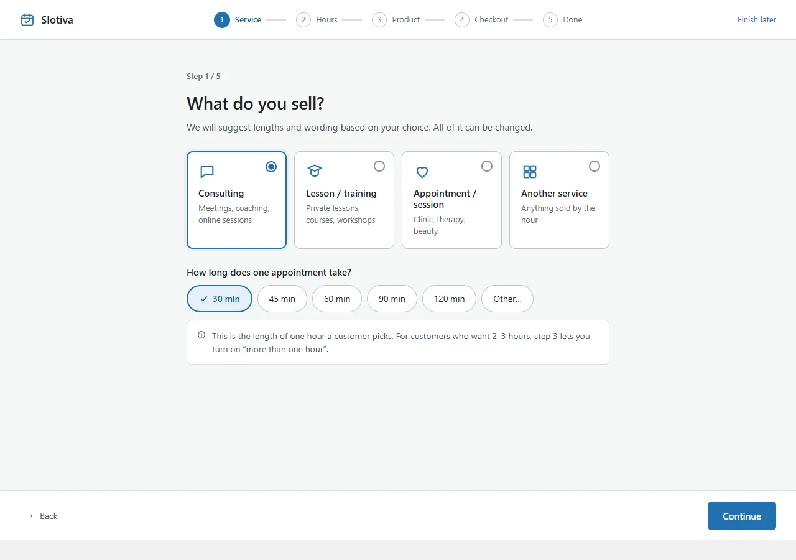
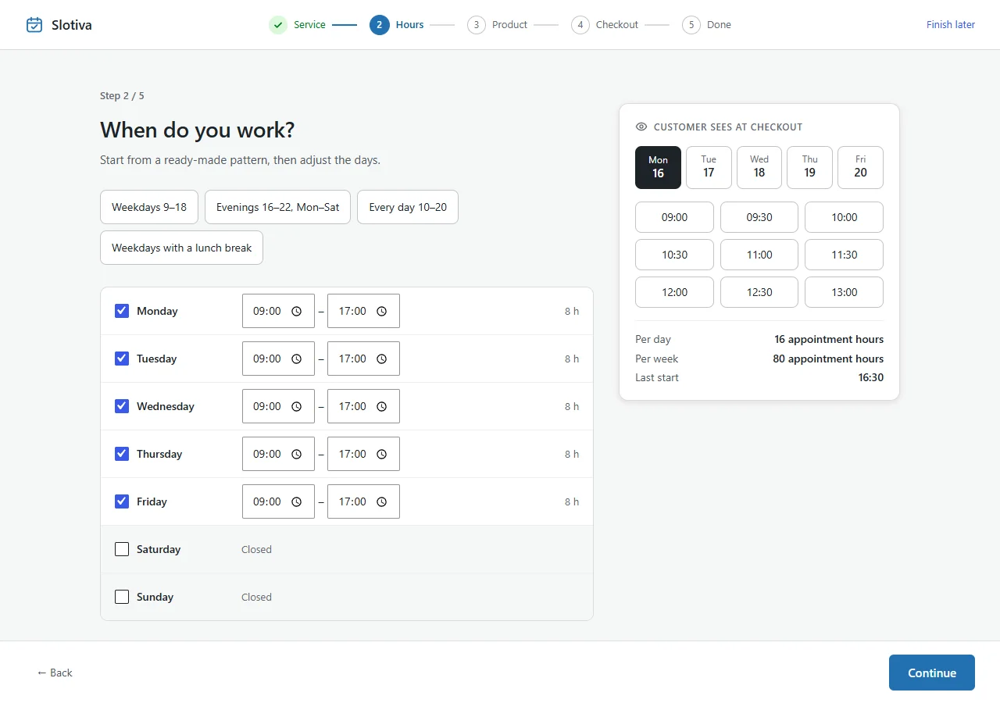
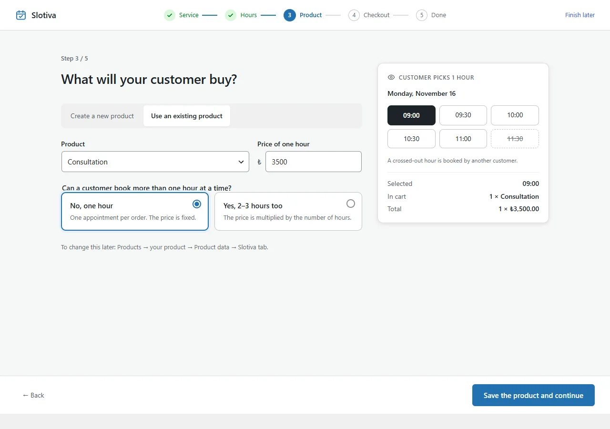
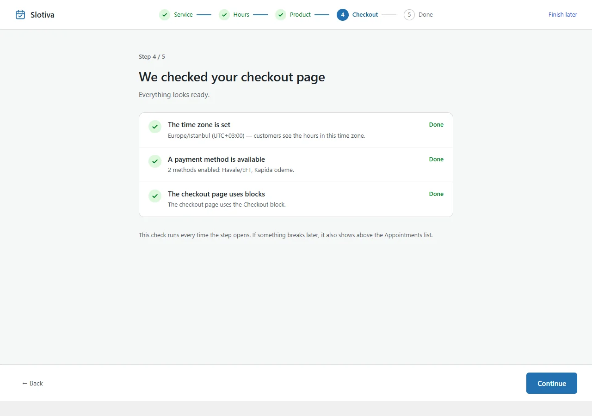
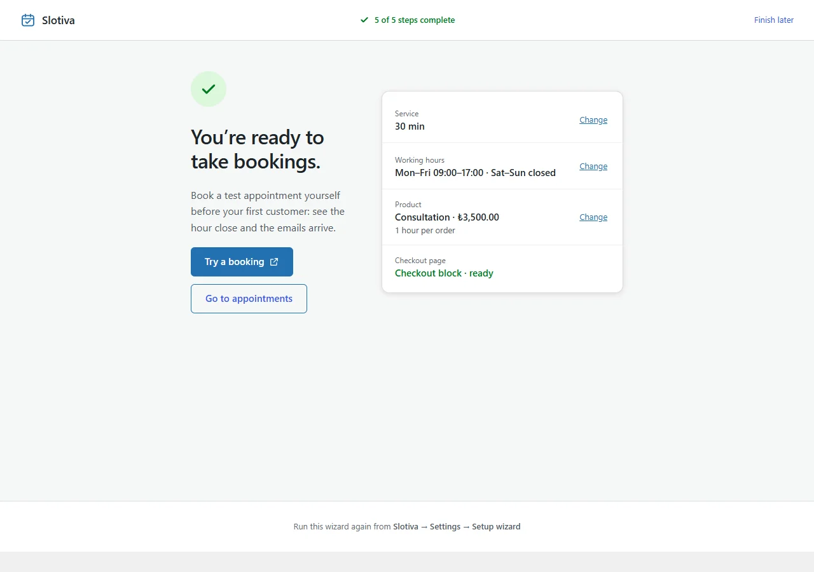
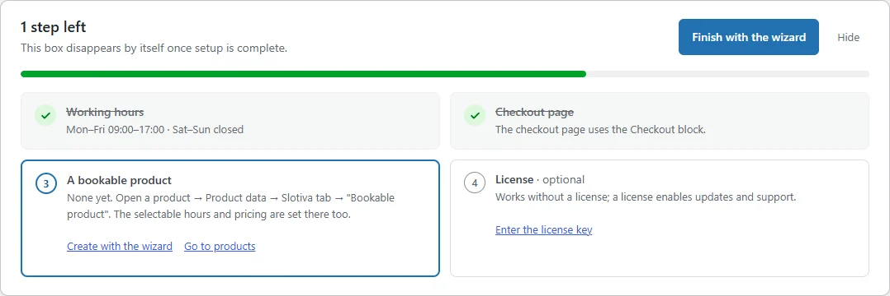

# Setup wizard

The wizard opens right after you activate Slotiva. It takes about three minutes and every answer can be changed later. You can
leave at any time with **Finish later**; your progress is saved step by step.

## Step 1 — Service {#step-1}

Choose what you sell: **Consulting**, **Lesson / training**, **Appointment / session** or **Another service**. Slotiva uses your
choice to suggest lengths and wording. Then choose how long one appointment lasts: 30, 45, 60, 90 or 120 minutes, or **Other…** for any multiple of
15 minutes.

The length you pick here is one "hour" your customer books. Customers who want longer sessions can book several in a row — you
allow that in step 3.

## Step 2 — Working hours {#step-2}

Start from a ready-made pattern — **Weekdays 9–18**, **Evenings 16–22, Mon–Sat**, **Every day 10–20** or **Weekdays with a lunch
break** — then adjust the days. The panel on the right shows what your customers will see at checkout and how many appointments
fit in a day and a week.

At least one day must be open to continue: a store with no open hours has nothing to sell.

## Step 3 — Product {#step-3}

Decide what the customer buys:

- **Create a new product** — enter a name and the price of one hour. Slotiva creates a published, virtual WooCommerce product.
- **Use an existing product** — pick one of your products and set its price of one hour. If the product is a draft or private,
  the wizard tells you it will be published.

Then answer **Can a customer book more than one hour at a time?**

- **No, one hour** — one appointment per order, fixed price.
- **Yes** — the price is multiplied by the number of hours. Set **At most per order** (2 to 10); the table below shows the price for
  each number of hours.

## Step 4 — Checkout check {#step-4}

Slotiva checks three things every time this step opens:

- **Time zone** — a city time zone (for example Europe/Istanbul) is fine. A fixed UTC offset (such as +03:00) is marked
  **Check**, because it does not follow daylight saving changes. Change it in **Settings → General**.
- **Payment method** — at least one payment method should be enabled in WooCommerce.
- **Checkout block** — the checkout page must use the Checkout block. If it does not, the button **Convert the checkout page to
  blocks** opens the page editor: select the Classic Checkout block and choose **Transform into blocks**.

Items marked **Check** do not stop you; you can continue or choose **I'll do this later**.

## Step 5 — Done {#step-5}

A summary of your service, working hours, product and checkout page. **Change** takes you back to that step (the checkout row has
it only when something needs attention). Before your
first customer, use **Try a booking** (opens your product page in a new tab) to book a test appointment yourself: see the time
close and the emails arrive.

## The setup checklist

Until the three required items — working hours, checkout page and a bookable product — are done, **Slotiva → Appointments**
shows a checklist above the list. It disappears by itself once setup is complete, or you can hide it.

## Running the wizard again

Go to **Slotiva → Settings** and click **Open the setup wizard**. It starts with your current settings and your existing
bookable product selected.
