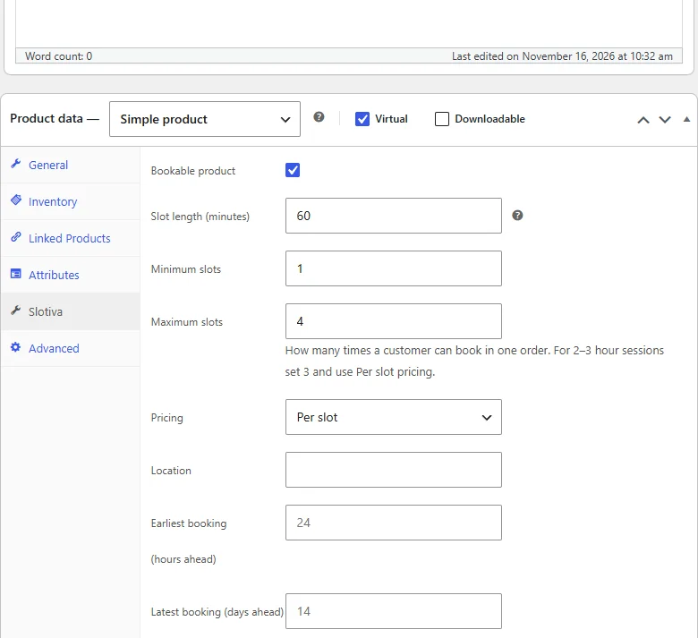

# Bookable product

Any **simple** or **variable** WooCommerce product can be sold as appointments. The setup wizard creates or prepares one for you;
for more products, or to fine-tune one, open the product and go to **Product data → Slotiva**.

## Fields

| Field | What it does |
|---|---|
| **Bookable product** | Turns booking on for this product. The time picker appears at checkout when it is in the cart. |
| **Slot length (minutes)** | How long one appointment lasts. Must be a multiple of 15. |
| **Minimum slots** / **Maximum slots** | How many times a customer can book in one order, from 1 to 10 (minimum ≤ maximum). For 2–3 hour sessions set the maximum to 3 and use *Per slot* pricing. |
| **Pricing** | **Per slot** — the product price is for one time; the cart quantity follows the number of times chosen. **Fixed (single slot)** — one price for one appointment. |
| **Location** | Optional. Shown with the appointment (for example an address or "Online"). |
| **Earliest booking (hours ahead)** | Optional. Leave empty to use the general rule on Slotiva → Working hours. |
| **Latest booking (days ahead)** | Optional, 1 to 62. Leave empty to use the general rule. |
| **Cancellation and change policy** | Optional. Leave empty to use the general policy from Slotiva → Settings. |

If a value is not valid (for example a length of 50 minutes), WooCommerce shows an error at the top of the product page and none
of the Slotiva fields are saved, so the product keeps its previous settings.

## Price

The price is the product's normal WooCommerce price. With **Per slot** pricing it is the price of one time: a customer who books
three times pays three times the price. A price of 0 is allowed (for example a free first consultation).

## All bookable products at a glance

**Slotiva → Settings → Bookable products** lists every bookable product with its length, hours per order and pricing, and links
to each product's Slotiva tab.
