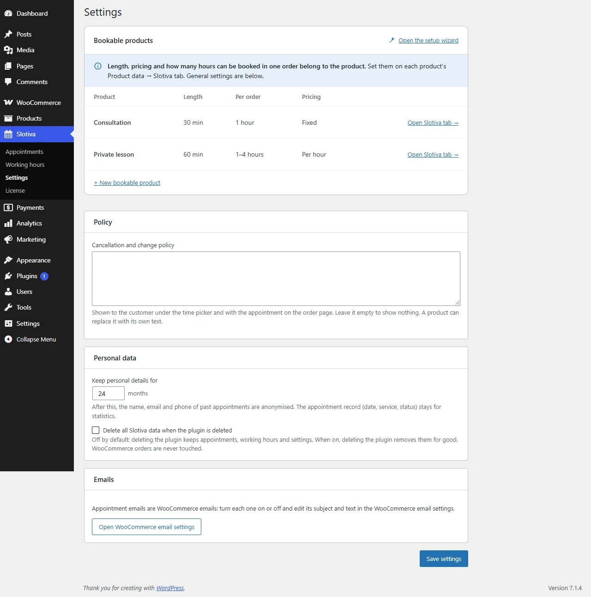

# Settings and emails

**Slotiva → Settings** collects what is not tied to working hours.

## Bookable products

Every bookable product with its length, hours per order and pricing. **Open Slotiva tab** goes to the product's own settings;
**+ New bookable product** and **Open the setup wizard** start the wizard. See [Bookable product](./bookable-product.md).

## Policy

**Cancellation and change policy** — your text is shown to the customer under the time picker and with the appointment on the
order page. Leave it empty to show nothing. A product can replace it with its own text.

## Personal data

- **Keep personal details for** (default 24 months, 1 to 120) — after this, the name, email and phone of past appointments are
  anonymised. The appointment record (date, service, status) stays for statistics.
- **Delete all Slotiva data when the plugin is deleted** — off by default: deleting the plugin keeps appointments, working hours
  and settings. When on, deleting the plugin removes them for good. WooCommerce orders are never touched.

WordPress's own **personal data export and erasure** tools (Tools → Export / Erase Personal Data) include appointments and their
history.

## Emails {#emails}

Appointment emails are WooCommerce emails. Turn each one on or off and edit its subject and text in **WooCommerce → Settings →
Emails** (the **Open WooCommerce email settings** button takes you there).

| Email | Sent to | When |
|---|---|---|
| Booking confirmed | Customer | Once per order, when every appointment of the order is confirmed. |
| Booking reminder | Customer | Before the appointment — set the time on Slotiva → Working hours (default 24 hours before). |
| Booking time changed | Customer | You moved the appointment and ticked *Email the new time to the customer*. |
| Booking cancelled | Customer | An appointment is cancelled, or a bank-transfer deadline passes. |
| New booking | Shop | Once per order, when a booking is confirmed. |
| Booking conflict | Shop | A paid order could not keep its time (see [Appointments](../03-daily-use/appointments.md#conflicts)). Refund or set a new time by hand. |

These emails carry a calendar file (.ics); the cancellation email carries a calendar cancellation, so the appointment disappears
from the customer's calendar app.
