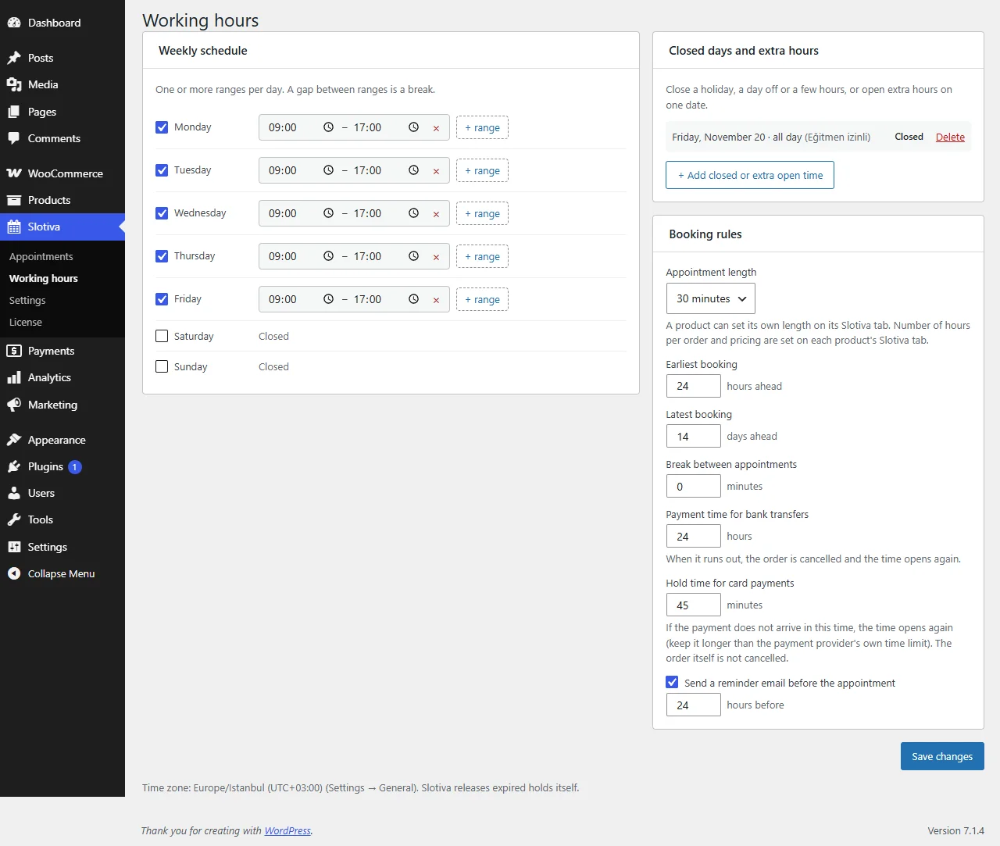

# Working hours and booking rules

Everything on this page lives on **Slotiva → Working hours**. Changes take effect for new bookings as soon as you click **Save
changes**; existing appointments are not moved.

## Weekly schedule

Tick the days you work and set the hours. A day can have **more than one range** — click **+ range** to add one. The gap
between two ranges is a break (for example a lunch break: 09:00–12:00 and 13:00–18:00). Unticked days are closed.

Customers can only pick times that fit completely inside a range.

## Closed days and extra hours

Use **Add closed or extra open time** for one date:

- **Closed** — a holiday, a day off, or just a few hours.
- **Extra open time** — open on a day or at hours you normally do not work.

Each entry can carry a short note for yourself. Entries are listed with a **Delete** link.

## Booking rules

| Rule | Default | What it does |
|---|---|---|
| Appointment length | 30 minutes | Default length of one appointment. A product can set its own length on its Slotiva tab. A multiple of 15 minutes, at most 480 (8 hours). |
| Earliest booking | 24 hours ahead | How soon a customer can book. With 24, a customer cannot book a time that starts in the next 24 hours. |
| Latest booking | 14 days ahead | How far ahead customers can book (1 to 62 days). |
| Break between appointments | 0 minutes | Free time kept after each appointment. |
| Payment time for bank transfers | 24 hours | The time is held this long for a bank-transfer order. When it runs out, the order is cancelled and the time opens again. |
| Hold time for card payments | 45 minutes | The time is held this long while a card payment completes (at least 15). If the payment does not arrive, the time opens again; the order itself is not cancelled. With PayTR, Slotiva automatically uses the longer of this value and PayTR's own time limit + 15 minutes; with other card providers, set it longer than the provider's time limit yourself. |
| Reminder email | On, 24 hours before | Sends the customer a reminder before the appointment. |

Products can override **Earliest booking** and **Latest booking** on their own Slotiva tab — see
[Bookable product](./bookable-product.md).

## Time zone

Slotiva shows and books every time in your site's time zone, set in **Settings → General**. Choose a **city** (for example
Europe/Istanbul) rather than a fixed offset like UTC+3: a city follows daylight saving changes, a fixed offset does not. The
setup wizard (step 4) warns you when a fixed offset is used.

Slotiva releases expired holds by itself; you do not need to set up anything for that.
