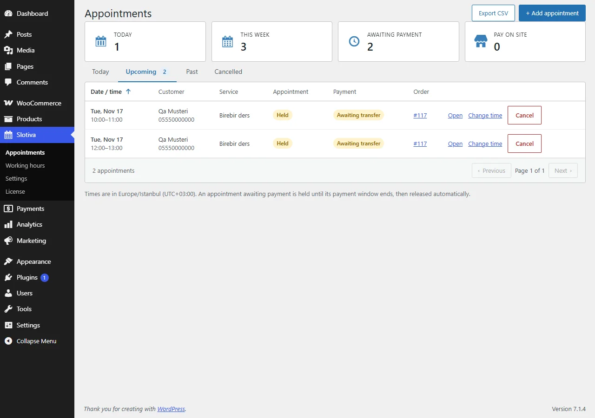
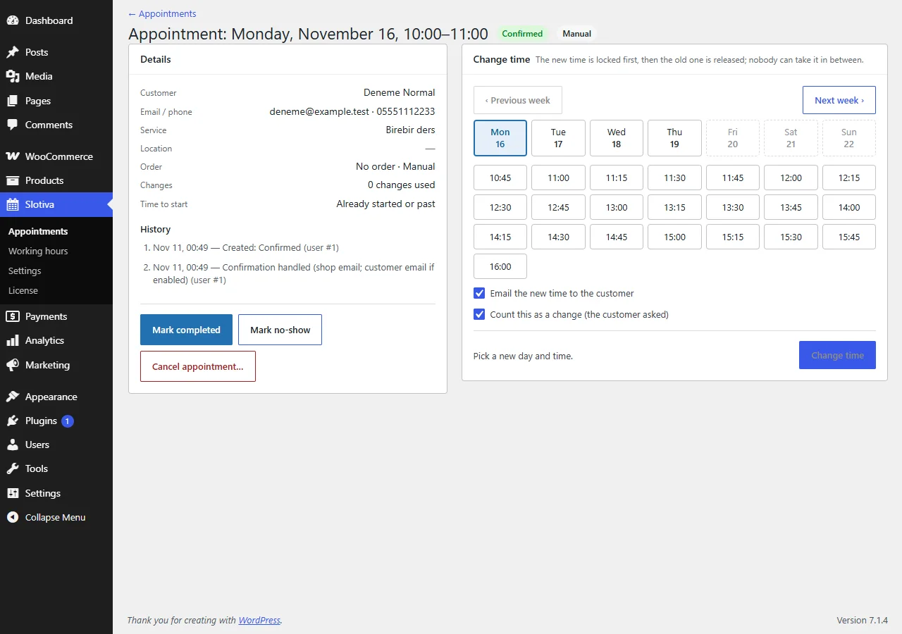

# Managing appointments

## The appointments list

**Slotiva → Appointments** opens with four counters — **Today**, **This week**, **Awaiting payment** and **Pay on site** — and the
list in four tabs: **Today**, **Upcoming**, **Past** and **Cancelled**.

Each row shows the date and time, the customer and phone, the service, the appointment status, the payment status and the order.
From the row you can **Open** the appointment, **Change time** or **Cancel**. All times are in your site's time zone (shown under
the list).

### Statuses

- **Held** — the customer is paying; the time is kept for them.
- **Confirmed** — booked.
- **Completed** / **No-show** — marked by you after the appointment.
- **Cancelled**.
- **Expired** — the payment did not arrive within the hold time; the time opened again.
- **Conflict** — a late payment arrived but the time was already taken (see [below](#conflicts)).

## The appointment detail

Click **Open** to see the customer, service, location, order, the number of changes used and the full **History** of the
appointment.

From here you can:

- **Change time** — pick a new day and time. The new time is locked first, then the old one is released, so nobody can take it in
  between. Tick **Email the new time to the customer** to send the *Booking time changed* email, and **Count this as a change**
  when the customer asked for it.
- **Mark completed** or **Mark no-show** after the appointment.
- **Cancel appointment…** — the time opens again (a *Conflict* appointment never held a time, so nothing opens).
- For a bank-transfer order that is awaiting payment, **extend the payment window**.

## Adding an appointment by hand

For phone or walk-in bookings, click **+ Add appointment**, choose the service and a free time, and enter the customer's name
(required), phone and email.
The appointment is created without a WooCommerce order and marked **Manual**.

## Exporting

**Export CSV** downloads the list. The file opens correctly in Excel with Turkish settings (UTF-8, `;` separator) and cells are
made safe against spreadsheet formulas.

## Late payments and conflicts {#conflicts}

Sometimes a payment arrives after its hold has run out. If the time is still free, Slotiva books it again. If someone else has taken
it meanwhile, the appointment is marked as a conflict and the shop receives the **Booking conflict** email: refund the order or set
a new time by hand.
