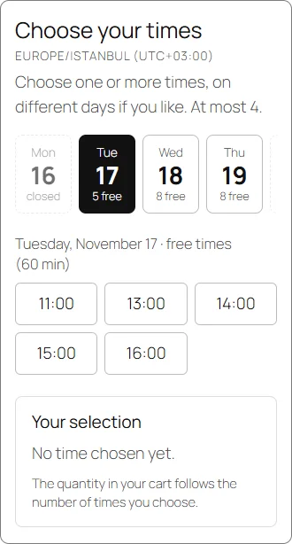
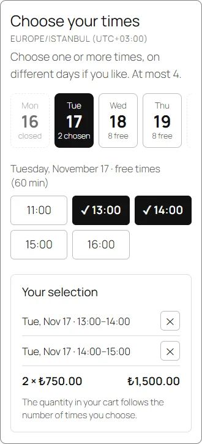
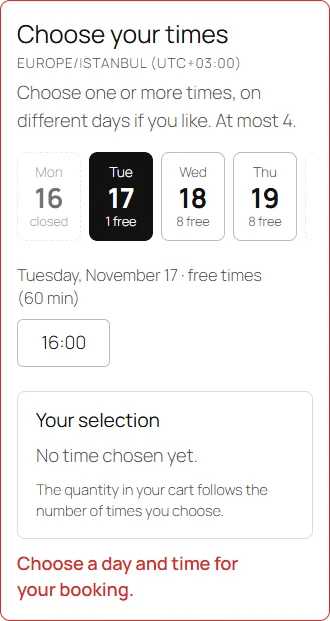
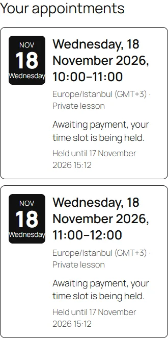

# What your customers see

Slotiva adds no booking page of its own: your customer books on the **WooCommerce checkout page**, in the same step as paying.

## Choosing times at checkout

When a bookable product is in the cart, the checkout shows **Choose your times** (or **Choose your time** when the product allows
one time per order):

- a **day strip** with how many times are free on each day — closed days are marked;
- the **free times** of the selected day;
- **Your selection**, with the price and a button to remove each time.

Customers can choose one or more times, also on **different days**, up to the product's maximum. With per-hour pricing the cart
quantity follows the number of times chosen — the customer does not change the quantity themselves.

If the customer presses **Place order** without choosing a time, the picker shows **Choose a day and time for your booking.**,
scrolls into view and takes the focus.

### When a time is taken in the meantime

Two customers can look at the same free time. The first one to place the order gets it; the second sees that one of their times
was just taken, the free times are refreshed and **their details stay filled in**, so they only choose again.

## While the customer pays {#while-paying}

| Payment | What happens to the time |
|---|---|
| Card (for example PayTR) | Held for the card payment window (Slotiva → Working hours, default 45 minutes). A failed payment keeps the hold, so the customer can retry from the order's payment page. Card orders are never cancelled automatically. |
| Bank transfer | Held until the transfer deadline (default 24 hours). If the money does not arrive, the order is cancelled and the time opens again. |
| Pay on site, free orders | Confirmed at once. |

A customer who already has several orders awaiting payment is asked to complete them before booking more.

## After the order

The order confirmation page and **My account → Orders** show an **appointment card** for each booked time, with the date, time,
time zone, service and its status (for example *Awaiting payment, your time slot is being held*). Confirmed appointments offer a
**calendar file (.ics)** and a **Google Calendar** link.

The customer also receives emails: booking confirmed, a reminder before the appointment, time changed and booking cancelled — see
[Settings and emails](../02-configuration/settings.md#emails).
