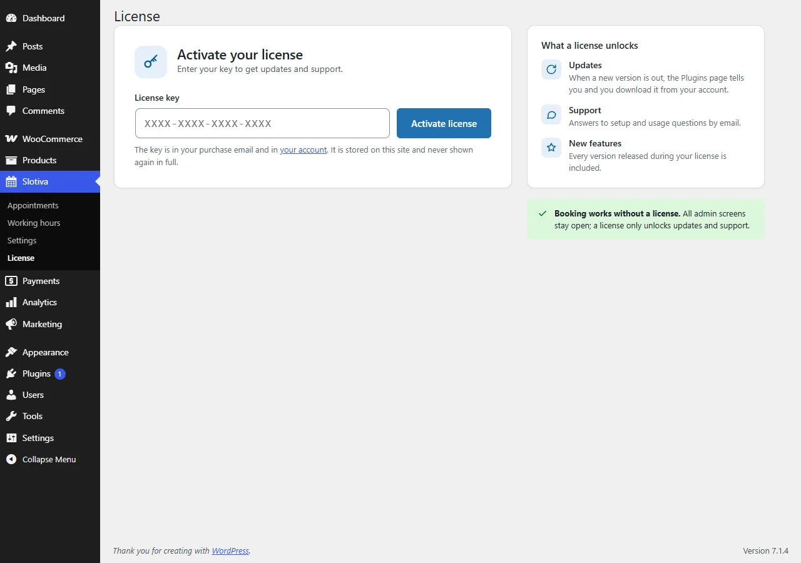
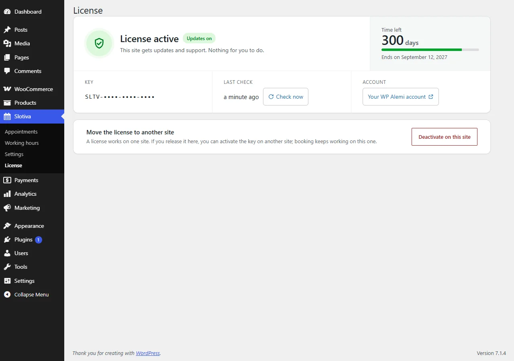
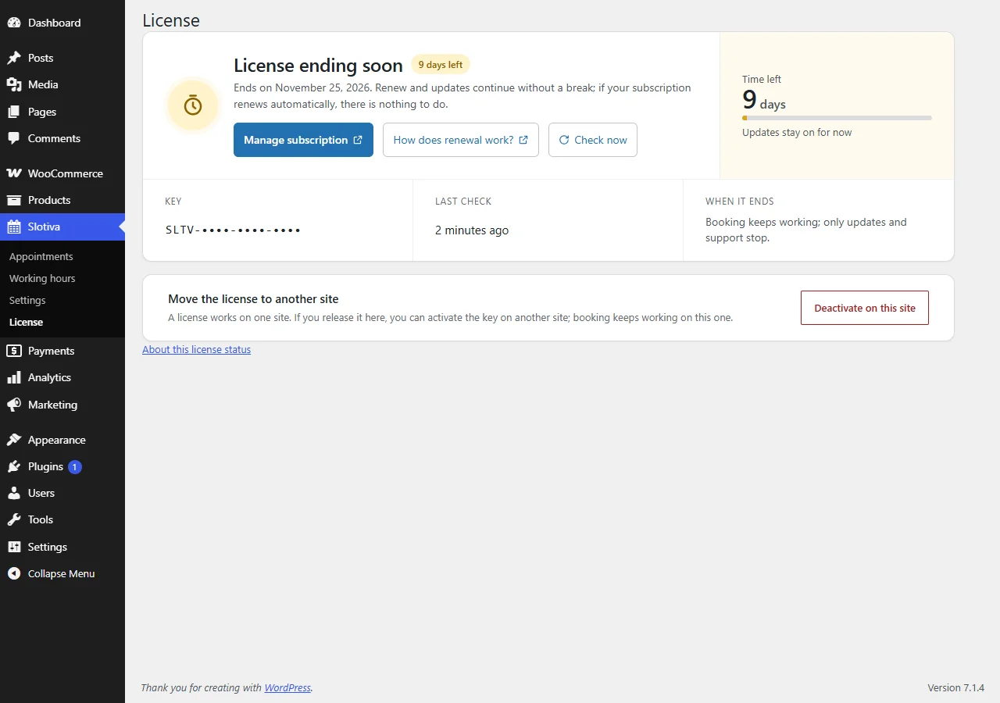
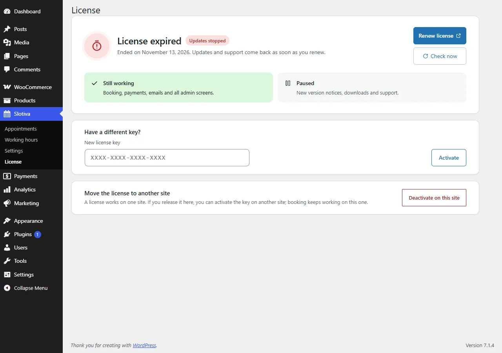
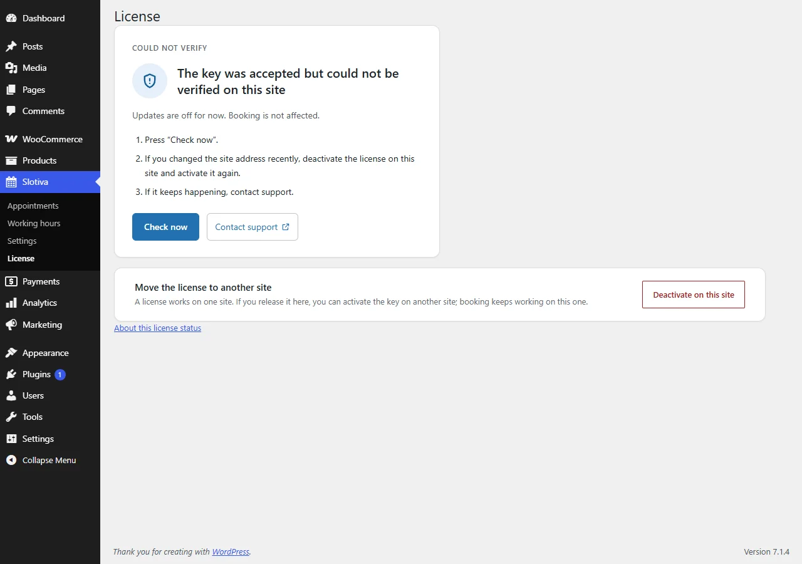
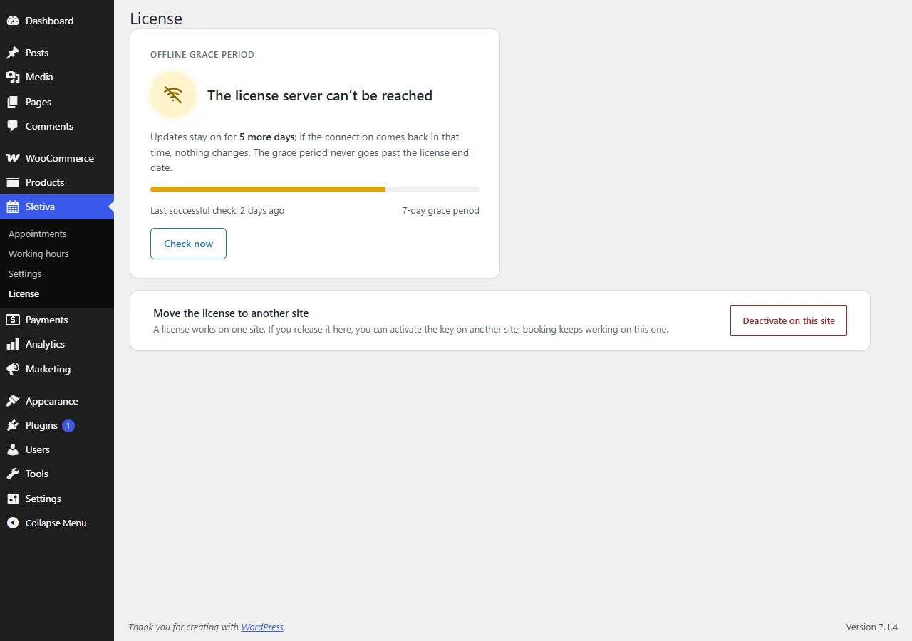

# License and support

## What a license unlocks

**Booking works without a license.** All admin screens stay open; a license only unlocks:

- **Updates** — when a new version is out, the Plugins page tells you and you download it from your account.
- **Support** — answers to setup and usage questions by email.
- **New features** — every version released during your license is included.

## Activating

Open **Slotiva → License**, paste your key and click **Activate license**. The key is in your purchase email and in
[your account](https://wpalemi.com/account/). It is stored on your site and never shown again in full — the screen shows only its
first 4 characters.

## License states

The license screen always shows one of these states.

### Active {#active}

Updates and support are on. The screen shows the days left, the end date, when the license was last checked (**Check now** checks
again) and a link to your account.

### Ending soon {#expiring}

The license ends within 14 days. Updates and support still work; renew and they continue without a break — if your subscription
renews automatically, there is nothing to do. **Manage subscription** opens your account.

### Expired {#expired}

The end date has passed. **What keeps working:** booking, payments, emails and every admin screen. **What stops:** new-version
notices, the right to download new versions, and support. **Renew license** opens your account; renewing brings updates and support
back at once. If you have a different key, enter it under **Have a different key?**.

### Not verified on this site {#unverified}

The key was accepted but could not be verified on this site. Updates are paused; booking is not affected. Click **Check now**. If
you recently changed the site address, deactivate the license on this site and activate it again. If it continues, contact
support.

### License server can't be reached {#offline}

Slotiva could not reach the license server. Updates stay on for up to **7 days** after the last successful check; if the connection
comes back in that time, nothing changes. The grace period never goes past the license end date. **Check now** tries again.

## Moving the license to another site

A license works on one site. Click **Deactivate on this site** (shown in every state) to release it; you can then activate the key
on another site. Booking keeps working on the old one.

## Getting help

Support questions go through your account at [wpalemi.com](https://wpalemi.com/account/). Please include your Slotiva version
(shown on the Plugins screen) and what you were doing when the problem appeared.
