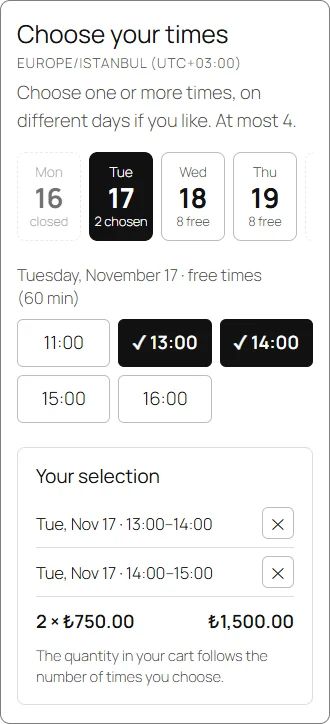

# What is MHM Slotiva?

MHM Slotiva turns a WooCommerce product into a **bookable service sold by the hour**: a consultation, a private lesson, a
therapy session, a coaching call. Your customer chooses a day and one or more times **inside the WooCommerce checkout page**
and pays for the order in one step. While the payment is pending, the time is held for them, so two customers can never book
the same time.

## How a booking flows

1. **The customer adds your service to the cart** and goes to the checkout.
2. **On the checkout page they pick a day and one or more times.** Times can be on different days. With per-hour pricing the
   cart quantity follows the number of times they choose.
3. **They place the order.** Slotiva holds the chosen times while the payment is completed:
   - **Card payment:** the time is held for the card payment window (45 minutes by default).
   - **Bank transfer:** the time is held until the transfer deadline (24 hours by default). If no payment arrives, the order is
     cancelled and the time opens again.
   - **Pay on site** and free orders: the appointment is confirmed at once.
4. **The appointment is confirmed** and the customer gets an email with a calendar file. They also see their appointments on
   the order page and in *My account*.
5. **You manage it in WordPress:** Slotiva → Appointments shows today's, upcoming, past and cancelled appointments. You can
   change the time, cancel, or add appointments by hand.

## Who it is for

Anyone who sells time: consultants, tutors and teachers, clinics and therapists, coaches. One store can have several bookable
products, each with its own length, price and number of hours per order.

## What it does not do (yet)

- Choosing a staff member (doctor, teacher) for the appointment.
- Capacity: more than one customer in the same time (group classes).

## Next steps

- [Install Slotiva](./01-getting-started/installation.md) and check the requirements.
- [Run the setup wizard](./01-getting-started/setup-wizard.md) — it takes a few minutes.
