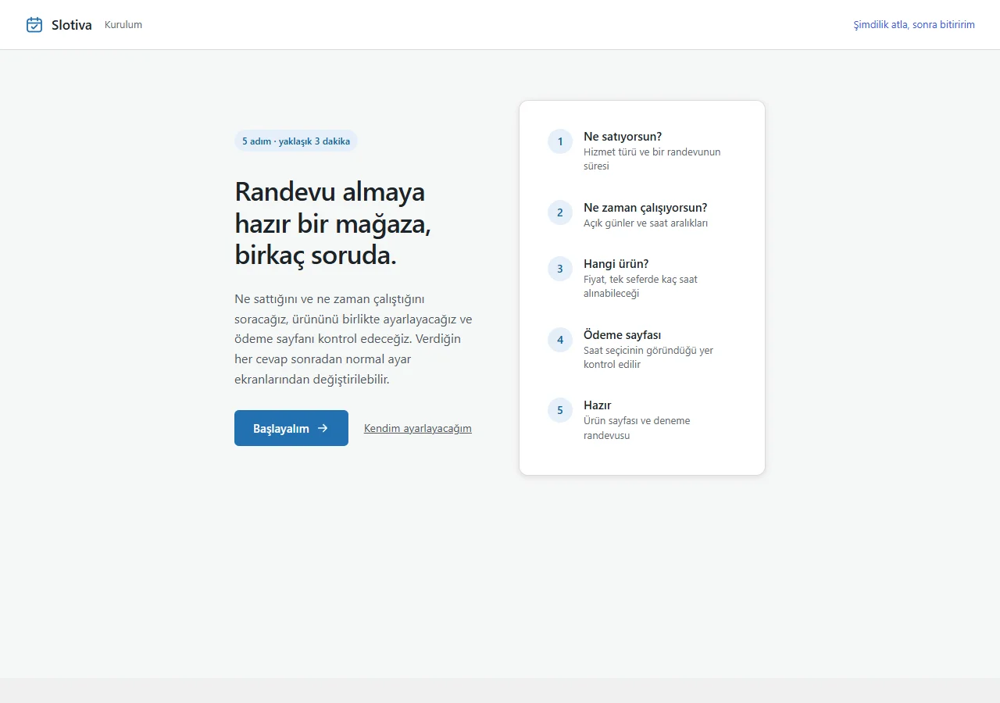
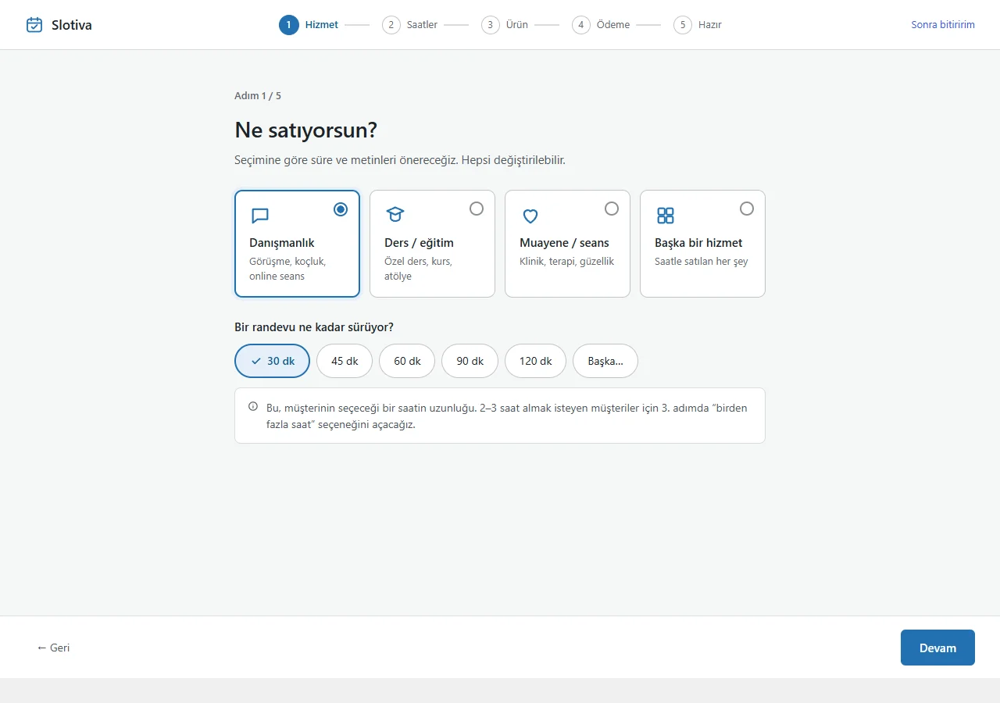
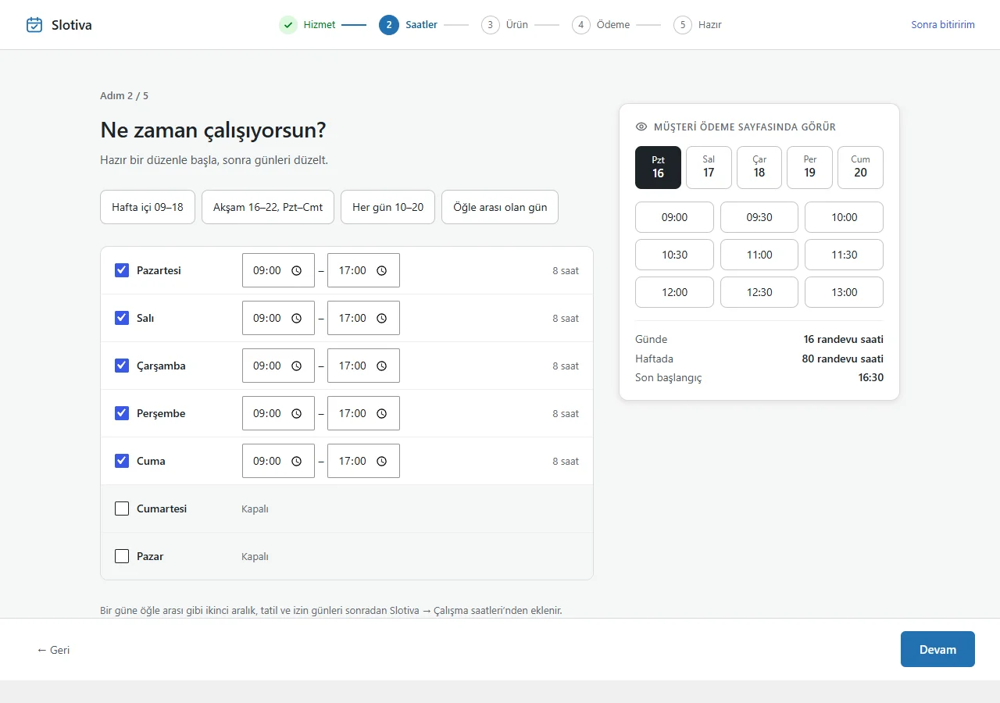
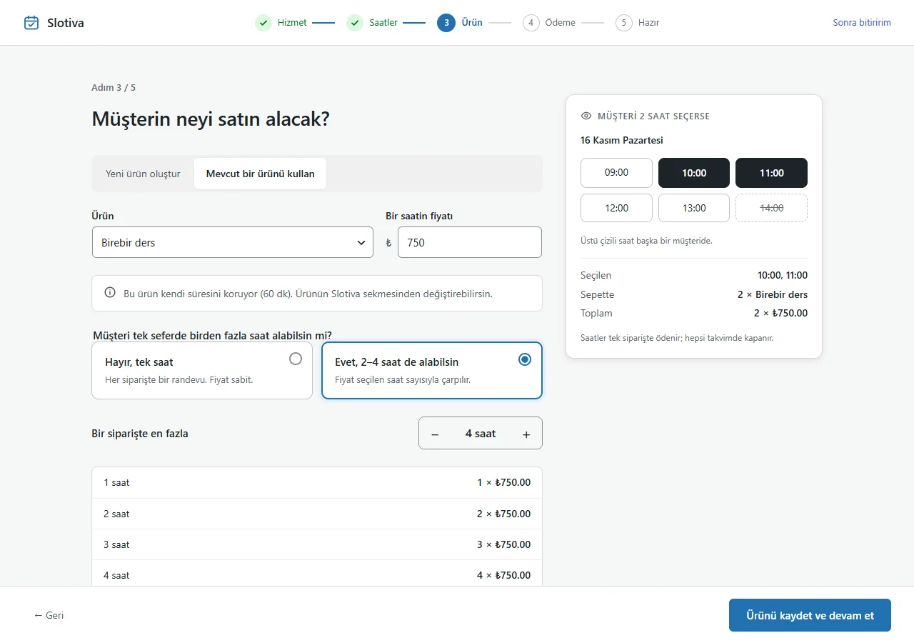
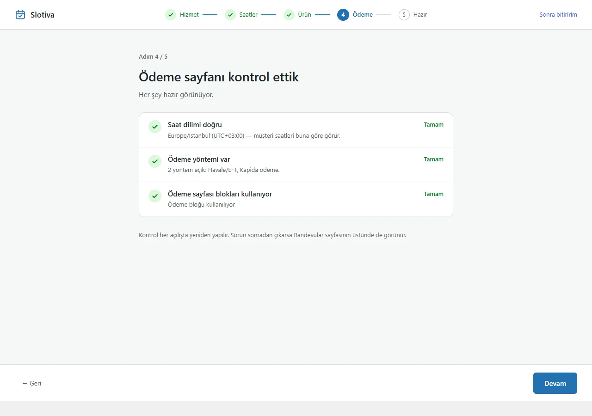
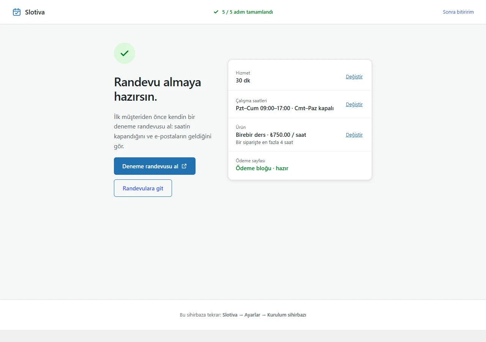
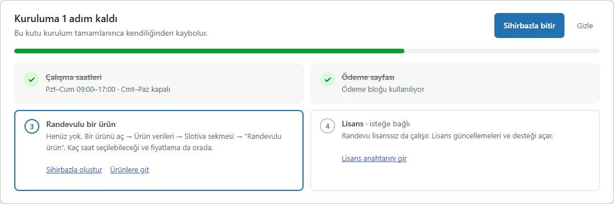

# Kurulum sihirbazı

Sihirbaz, Slotiva'yı etkinleştirir etkinleştirmez açılır. Yaklaşık üç dakika sürer ve her cevap sonradan değiştirilebilir.
İstediğin an **Sonra bitiririm** ile çıkabilirsin; ilerlemen adım adım kaydedilir.

## Adım 1 — Hizmet {#step-1}

Ne sattığını seç: **Danışmanlık**, **Ders / eğitim**, **Muayene / seans** ya da **Başka bir hizmet**. Slotiva seçimine göre süre ve
metin önerir. Sonra bir randevunun ne kadar sürdüğünü seç: 30, 45, 60, 90 ya da 120 dakika veya 15 dakikanın herhangi bir katı
için **Başka…**.

Burada seçtiğin süre, müşterinin aldığı bir "saat"tir. Daha uzun seans isteyen müşteri art arda birkaç saat alabilir — buna 3.
adımda izin verirsin.

## Adım 2 — Çalışma saatleri {#step-2}

Hazır bir kalıpla başla — **Hafta içi 09–18**, **Akşam 16–22, Pzt–Cmt**, **Her gün 10–20** ya da **Öğle arası olan gün** — sonra
günleri düzenle. Sağdaki panel, müşterinin ödeme sayfasında ne göreceğini ve bir günde ve haftada kaç randevu sığdığını gösterir.

Devam etmek için en az bir gün açık olmalı: hiç açık saati olmayan bir mağazanın satacağı bir şey yoktur.

## Adım 3 — Ürün {#step-3}

Müşterinin ne satın alacağına karar ver:

- **Yeni ürün oluştur** — bir ad ve bir saatin fiyatını gir. Slotiva yayında, sanal bir WooCommerce ürünü oluşturur.
- **Mevcut bir ürünü kullan** — ürünlerinden birini seç ve bir saatin fiyatını belirle. Ürün taslak ya da özelse sihirbaz onun
  yayınlanacağını söyler.

Sonra şu soruyu cevapla: **Müşteri tek seferde birden fazla saat alabilsin mi?**

- **Hayır, tek saat** — her siparişte bir randevu, sabit fiyat.
- **Evet** — fiyat saat sayısıyla çarpılır. **Bir siparişte en fazla** değerini seç (2 ile 10 arası); alttaki tablo her saat
  sayısı için fiyatı gösterir.

## Adım 4 — Ödeme sayfası kontrolü {#step-4}

Slotiva bu adım her açıldığında üç şeyi kontrol eder:

- **Saat dilimi** — bir şehir saat dilimi (örneğin Europe/Istanbul) uygundur. Sabit bir UTC ofseti (örneğin +03:00) **Kontrol
  et** olarak işaretlenir, çünkü yaz saati değişikliklerini izlemez. **Ayarlar → Genel**'den değiştirebilirsin.
- **Ödeme yöntemi** — WooCommerce'te en az bir ödeme yöntemi açık olmalı.
- **Ödeme bloğu** — ödeme sayfası Ödeme (Checkout) bloğunu kullanmalı. Kullanmıyorsa **Ödeme sayfasını bloğa çevir** düğmesi sayfa
  düzenleyicisini açar: Klasik Ödeme bloğunu seç ve “Bloklara dönüştür”ü seç.

**Kontrol et** ile işaretlenenler seni durdurmaz; devam edebilir ya da **Bunu sonra yaparım** diyebilirsin.

## Adım 5 — Bitti {#step-5}

Hizmetin, çalışma saatlerin, ürünün ve ödeme sayfanın özeti. **Değiştir** seni o adıma geri götürür (ödeme sayfası satırında
yalnız bir sorun varsa görünür). İlk müşteriden önce **Deneme randevusu al** (ürün sayfanı yeni sekmede açar) ile kendin bir
deneme randevusu al: saatin kapandığını ve e-postaların geldiğini gör.

## Kurulum listesi

Zorunlu üç madde — çalışma saatleri, ödeme sayfası ve randevulu bir ürün — tamamlanana kadar **Slotiva → Randevular** listenin
üstünde bir kurulum listesi gösterir. Kurulum tamamlanınca kendiliğinden kaybolur ya da onu gizleyebilirsin.

## Sihirbazı yeniden çalıştırmak

**Slotiva → Ayarlar**'a git ve **Kurulum sihirbazını aç**'a tıkla. Sihirbaz mevcut ayarlarınla ve mevcut randevulu ürünün seçili
olarak açılır.
