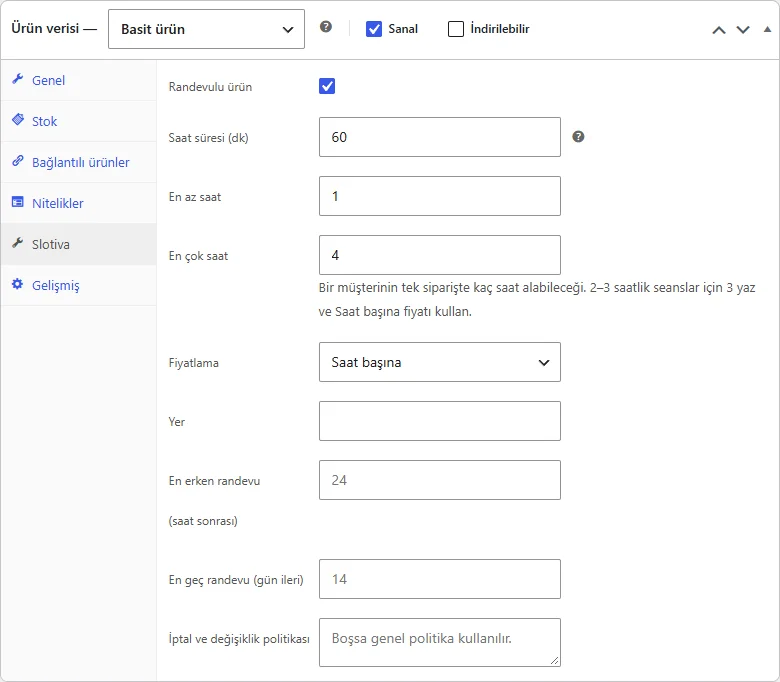

# Randevulu ürün

Her **basit** ya da **değişken** WooCommerce ürünü randevu olarak satılabilir. Kurulum sihirbazı senin için bir ürün oluşturur ya
da hazırlar; başka ürünler için ya da birini ince ayarlamak için ürünü aç ve **Ürün verileri → Slotiva**'ya git.

## Alanlar

| Alan | Ne yapar |
|---|---|
| **Randevulu ürün** | Bu ürün için randevuyu açar. Ürün sepetteyken ödeme sayfasında saat seçici görünür. |
| **Saat süresi (dk)** | Bir randevunun ne kadar sürdüğü. 15'in katı olmalı. |
| **En az saat** / **En çok saat** | Müşterinin bir siparişte kaç saat alabileceği, 1 ile 10 arası (en az ≤ en çok). 2–3 saatlik seanslar için en çoğu 3 yap ve *Saat başına* fiyatlamayı kullan. |
| **Fiyatlama** | **Saat başına** — ürün fiyatı bir saatin fiyatıdır; sepetteki adet seçilen saat sayısına eşitlenir. **Sabit (tek saat)** — bir randevu için tek fiyat. |
| **Yer** | İsteğe bağlı. Randevuyla birlikte gösterilir (örneğin bir adres ya da "Online"). |
| **En erken randevu (saat sonrası)** | İsteğe bağlı. Boş bırakırsan Slotiva → Çalışma saatleri'ndeki genel kural geçerli olur. |
| **En geç randevu (gün ileri)** | İsteğe bağlı, 1 ile 62 arası. Boş bırakırsan genel kural geçerli olur. |
| **İptal ve değişiklik politikası** | İsteğe bağlı. Boş bırakırsan Slotiva → Ayarlar'daki genel politika kullanılır. |

Bir değer geçerli değilse (örneğin 50 dakikalık bir süre) WooCommerce ürün sayfasının üstünde bir hata gösterir ve Slotiva
alanlarının hiçbiri kaydedilmez; ürün önceki ayarlarını korur.

## Fiyat

Fiyat, ürünün olağan WooCommerce fiyatıdır. **Saat başına** fiyatlamada bu bir saatin fiyatıdır: üç saat alan müşteri fiyatın üç
katını öder. 0 fiyat kabul edilir (örneğin ücretsiz ilk görüşme).

## Tüm randevulu ürünler tek bakışta

**Slotiva → Ayarlar → Randevulu ürünler**, her randevulu ürünü süresi, siparişteki saat sayısı ve fiyatlamasıyla listeler ve her
ürünün Slotiva sekmesine bağlantı verir.
