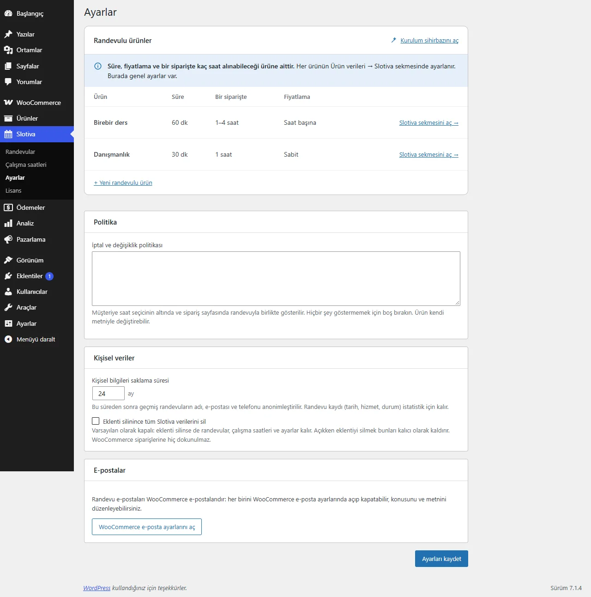

# Ayarlar ve e-postalar

**Slotiva → Ayarlar**, çalışma saatlerine bağlı olmayan her şeyi toplar.

## Randevulu ürünler

Her randevulu ürün; süresi, siparişteki saat sayısı ve fiyatlamasıyla (**Sabit** ya da **Saat başına**). **Slotiva sekmesini aç →** ürünün kendi ayarlarına gider;
**+ Yeni randevulu ürün** ve **Kurulum sihirbazını aç** sihirbazı başlatır. Bkz. [Randevulu ürün](./bookable-product.md).

## Politika

**İptal ve değişiklik politikası** — metnin müşteriye saat seçicinin altında ve sipariş sayfasında randevuyla birlikte gösterilir.
Boş bırakırsan hiçbir şey gösterilmez. Bir ürün bunu kendi metniyle değiştirebilir.

## Kişisel veriler

- **Kişisel bilgileri saklama süresi** (varsayılan 24 ay, 1 ile 120 arası) — bu süreden sonra geçmiş randevuların adı, e-postası ve
  telefonu anonimleştirilir. Randevu kaydı (tarih, hizmet, durum) istatistik için kalır.
- **Eklenti silinince tüm Slotiva verilerini sil** — varsayılan olarak kapalı: eklentiyi silmek randevuları, çalışma saatlerini ve
  ayarları korur. Açıkken eklentiyi silmek onları kalıcı olarak kaldırır. WooCommerce siparişlerine hiç dokunulmaz.

WordPress'in kendi **kişisel veri dışa aktarma ve silme** araçları (Araçlar → Kişisel verileri dışa aktar / Kişisel verileri sil)
randevuları ve geçmişlerini de kapsar.

## E-postalar {#emails}

Randevu e-postaları WooCommerce e-postalarıdır. Her birini **WooCommerce → Ayarlar → E-postalar**'da açıp kapatabilir, konusunu
ve metnini düzenleyebilirsin (**WooCommerce e-posta ayarlarını aç** düğmesi seni oraya götürür).

| E-posta | Kime | Ne zaman |
|---|---|---|
| Randevu onaylandı | Müşteri | Sipariş başına bir kez, siparişin tüm randevuları onaylanınca. |
| Randevu hatırlatması | Müşteri | Randevudan önce — süreyi Slotiva → Çalışma saatleri'nden ayarla (varsayılan 24 saat önce). |
| Randevu saati değişti | Müşteri | Randevuyu taşıdın ve *Müşteriye yeni saati e-postayla bildir*'i işaretledin. |
| Randevu iptal edildi | Müşteri | Bir randevu iptal edildi ya da havale süresi doldu. |
| Yeni randevu | Mağaza | Sipariş başına bir kez, randevu onaylanınca. |
| Randevu çakışması | Mağaza | Ödenmiş bir sipariş saatini koruyamadı (bkz. [Randevular](../03-daily-use/appointments.md#conflicts)). İade et ya da elle yeni saat ver. |

Bu e-postalar bir takvim dosyası (.ics) taşır; iptal e-postası bir takvim iptali taşır, böylece randevu müşterinin takvim
uygulamasından da kalkar.
