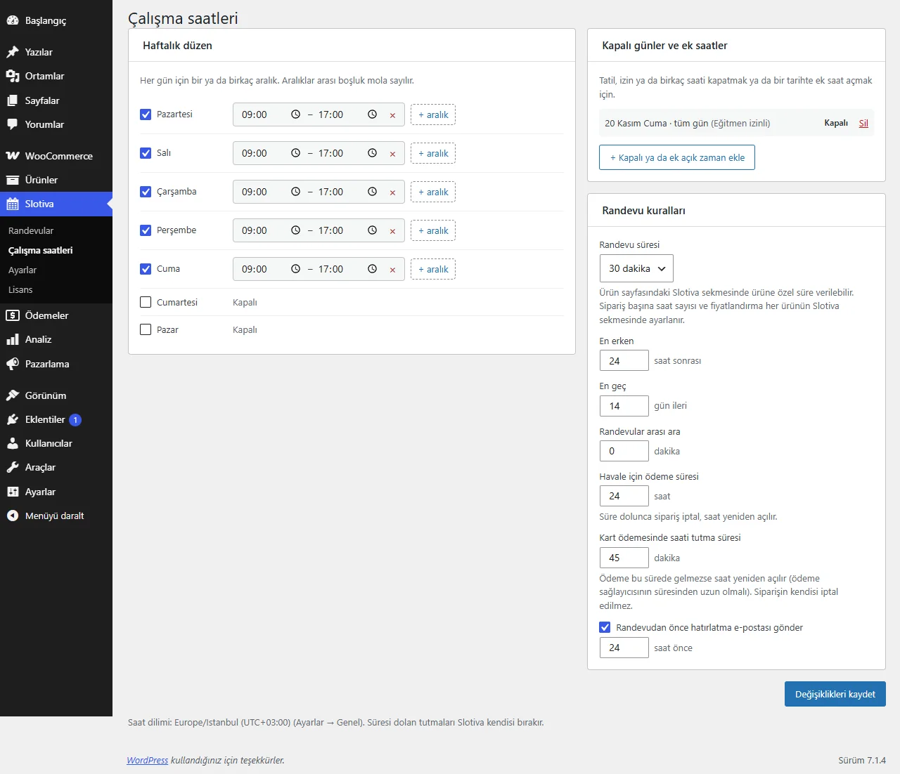

# Çalışma saatleri ve randevu kuralları

Bu sayfadaki her şey **Slotiva → Çalışma saatleri**'ndedir. **Değişiklikleri kaydet**'e tıkladığın anda yeni randevular için
geçerli olur; mevcut randevular kaydırılmaz.

## Haftalık düzen

Çalıştığın günleri işaretle ve saatleri gir. Bir günde **birden fazla aralık** olabilir — eklemek için **+ aralık**'a tıkla. İki
aralık arasındaki boşluk bir aradır (örneğin öğle arası: 09:00–12:00 ve 13:00–18:00). İşaretlenmeyen günler kapalıdır.

Müşteri yalnız bir aralığa tamamen sığan saatleri seçebilir.

## Kapalı günler ve ek saatler

Tek bir tarih için **+ Kapalı ya da ek açık zaman ekle**'yi kullan:

- **Kapalı** — tatil, izin günü ya da yalnız birkaç saat.
- **Ek açık zaman** — normalde çalışmadığın bir günde ya da saatlerde aç.

Her kayda kendin için kısa bir not ekleyebilirsin. Kayıtlar bir **Sil** bağlantısıyla listelenir.

## Randevu kuralları

| Kural | Varsayılan | Ne yapar |
|---|---|---|
| Randevu süresi | 30 dakika | Bir randevunun varsayılan süresi. Bir ürün kendi süresini Slotiva sekmesinde belirleyebilir. 15 dakikanın katı olmalı. |
| En erken | 24 saat sonrası | Müşterinin en erken ne zamana randevu alabileceği. 24 iken müşteri önümüzdeki 24 saat içinde başlayan bir saati alamaz. |
| En geç | 14 gün ileri | Müşterinin ne kadar ileriye randevu alabileceği (1 ile 62 gün arası). |
| Randevular arası ara | 0 dakika | Her randevudan sonra boş bırakılan süre. |
| Havale için ödeme süresi | 24 saat | Havale siparişinde saat bu kadar tutulur. Süre dolunca sipariş iptal edilir ve saat yeniden açılır. |
| Kart ödemesinde saati tutma süresi | 45 dakika | Kart ödemesi tamamlanırken saat bu kadar tutulur (en az 15). Ödeme gelmezse saat yeniden açılır; siparişin kendisi iptal edilmez. Ödeme sağlayıcının kendi süre sınırından uzun tut. |
| Hatırlatma e-postası | Açık, 24 saat önce | Müşteriye randevudan önce hatırlatma gönderir. |

Ürünler **En erken** ve **En geç** kurallarını kendi Slotiva sekmelerinde değiştirebilir — bkz.
[Randevulu ürün](./bookable-product.md).

## Saat dilimi

Slotiva her saati sitenin **Ayarlar → Genel**'deki saat diliminde gösterir ve satar. UTC+3 gibi sabit bir ofset yerine bir
**şehir** seç (örneğin Europe/Istanbul): şehir yaz saati değişikliklerini izler, sabit ofset izlemez. Sabit ofset kullanılıyorsa
kurulum sihirbazı (4. adım) seni uyarır.

Süresi dolan tutmaları Slotiva kendisi bırakır; bunun için bir şey ayarlaman gerekmez.
