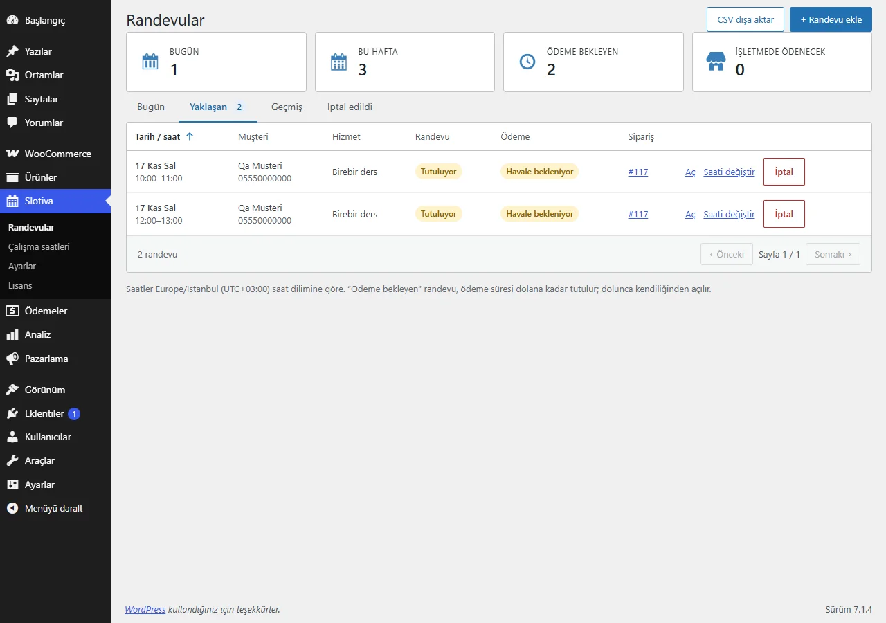
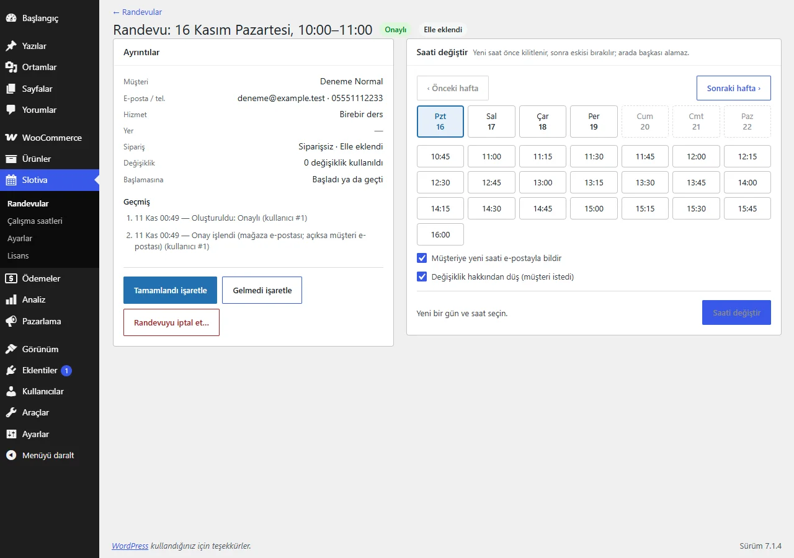

# Randevuları yönetmek

## Randevu listesi

**Slotiva → Randevular** dört sayaçla açılır — **Bugün**, **Bu hafta**, **Ödeme bekleyen** ve **İşletmede ödenecek** — ve liste dört
sekmededir: **Bugün**, **Yaklaşan**, **Geçmiş** ve **İptal edildi**.

Her satırda tarih ve saat, müşteri ve telefonu, hizmet, randevu durumu, ödeme durumu ve sipariş görünür. Satırdan randevuyu **Aç**,
**Saati değiştir** ya da **İptal** edebilirsin. Tüm saatler sitenin saat dilimindedir (listenin altında yazar).

### Durumlar

- **Tutuluyor** — müşteri ödüyor; saat onun için tutuluyor.
- **Onaylı** — randevu alındı.
- **Tamamlandı** / **Gelmedi** — randevudan sonra senin işaretlediğin.
- **İptal edildi**.
- **Süresi doldu** — ödeme tutma süresi içinde gelmedi; saat yeniden açıldı.
- **Çakışma** — geç bir ödeme geldi ama saat başkası tarafından alınmıştı (bkz. [aşağısı](#conflicts)).

## Randevu ayrıntısı

Müşteriyi, hizmeti, yeri, siparişi, kullanılan değişiklik sayısını ve randevunun tüm **Geçmiş**'ini görmek için **Aç**'a tıkla.

Buradan şunları yapabilirsin:

- **Saati değiştir** — yeni bir gün ve saat seç. Önce yeni saat kilitlenir, sonra eskisi bırakılır; arada kimse alamaz. *Randevu
  saati değişti* e-postasını göndermek için **Müşteriye yeni saati e-postayla bildir**'i, değişikliği müşteri istediyse **Değişiklik
  hakkından düş (müşteri istedi)**'yi işaretle.
- Randevudan sonra **Tamamlandı işaretle** ya da **Gelmedi işaretle**.
- **Randevuyu iptal et…** — saat yeniden açılır (*Çakışma* durumundaki bir randevu hiç saat tutmadığı için açılan bir şey olmaz).
- Ödeme bekleyen bir havale siparişinde **ödeme süresini uzat**.

## Elle randevu eklemek

Telefonla ya da gelerek alınan randevular için **+ Randevu ekle**'ye tıkla, hizmeti ve boş bir saati seç, müşterinin adını
(zorunlu), telefonunu ve e-postasını gir. Randevu WooCommerce siparişi olmadan oluşturulur ve **Elle eklendi** olarak işaretlenir.

## Dışa aktarmak

**CSV dışa aktar** listeyi indirir. Dosya Türkçe ayarlı Excel'de doğru açılır (UTF-8, `;` ayırıcı) ve hücreler elektronik tablo
formüllerine karşı güvenli hâle getirilir.

## Geç ödemeler ve çakışmalar {#conflicts}

Bazen bir ödeme, tutma süresi bittikten sonra gelir. Saat hâlâ boşsa Slotiva onu yeniden ayırır. Bu arada başkası almışsa randevu
çakışma olarak işaretlenir ve mağazaya **Randevu çakışması** e-postası gider: siparişi iade et ya da elle yeni bir saat ver.
