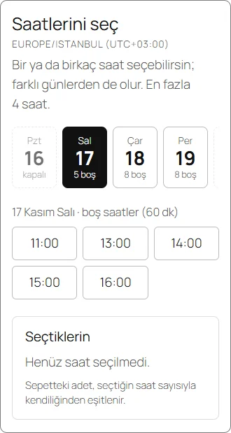
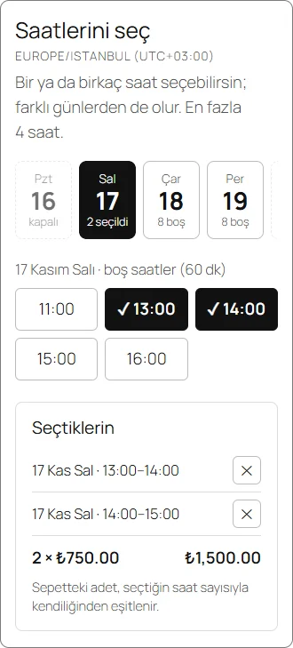
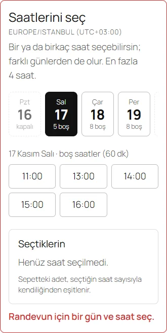
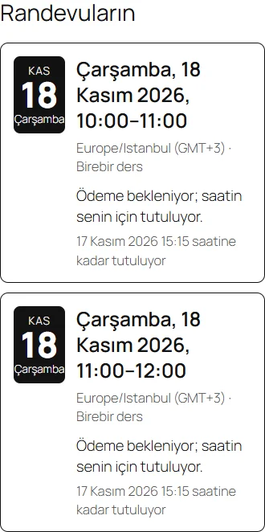

# Müşterinin gördükleri

Slotiva'nın ayrı bir randevu sayfası yoktur: müşterin **WooCommerce ödeme sayfasında**, ödemeyle aynı adımda randevu alır.

## Ödeme sayfasında saat seçmek

Sepette randevulu bir ürün varsa ödeme sayfası **Saatlerini seç** bölümünü gösterir (ürün siparişte tek saate izin veriyorsa
**Saatini seç**):

- her günde kaç saatin boş olduğunu gösteren bir **gün şeridi** — kapalı günler işaretlidir;
- seçilen günün **boş saatleri**;
- fiyatla birlikte **Seçtiklerin** ve her saati kaldırmak için bir düğme.

Müşteri ürünün izin verdiği en fazla sayıya kadar bir ya da birkaç saat, **farklı günlerde** de seçebilir. Saat başına fiyatlamada
sepetteki adet seçilen saat sayısına eşitlenir — müşteri adedi kendisi değiştirmez.

Müşteri saat seçmeden **Sipariş Ver**'e basarsa seçici **Randevun için bir gün ve saat seç.** iletisini gösterir, görünür alana
kayar ve odağı alır.

### Bu arada saat alınırsa

İki müşteri aynı boş saate bakıyor olabilir. Siparişi önce veren saati alır; ikincisi saatlerinden birinin az önce alındığını
görür, boş saatler yenilenir ve **bilgileri doldurulmuş kalır**, yalnız yeniden seçer.

## Müşteri öderken {#while-paying}

| Ödeme | Saate ne olur |
|---|---|
| Kart (örneğin PayTR) | Kart ödemesi süresince tutulur (Slotiva → Çalışma saatleri, varsayılan 45 dakika). Başarısız bir ödeme tutmayı korur; müşteri siparişin ödeme sayfasından yeniden deneyebilir. Kartlı siparişler asla kendiliğinden iptal edilmez. |
| Havale | Havale son tarihine kadar tutulur (varsayılan 24 saat). Para gelmezse sipariş iptal edilir ve saat yeniden açılır. |
| İşletmede ödeme, ücretsiz siparişler | Hemen onaylanır. |

Ödeme bekleyen birkaç siparişi olan müşteriden, daha fazla randevu almadan önce onları tamamlaması istenir.

## Siparişten sonra

Sipariş onay sayfası ve **Hesabım → Siparişler**, alınan her saat için tarih, saat, saat dilimi, hizmet ve durumuyla (örneğin
*Ödeme bekleniyor; saatin senin için tutuluyor.*) bir **randevu kartı** gösterir. Onaylı randevularda bir **takvim dosyası
(.ics)** ve bir **Google Takvim** bağlantısı bulunur.

Müşteriye ayrıca e-postalar gider: randevu onaylandı, randevudan önce hatırlatma, saat değişti ve randevu iptal edildi — bkz.
[Ayarlar ve e-postalar](../02-configuration/settings.md#emails).
