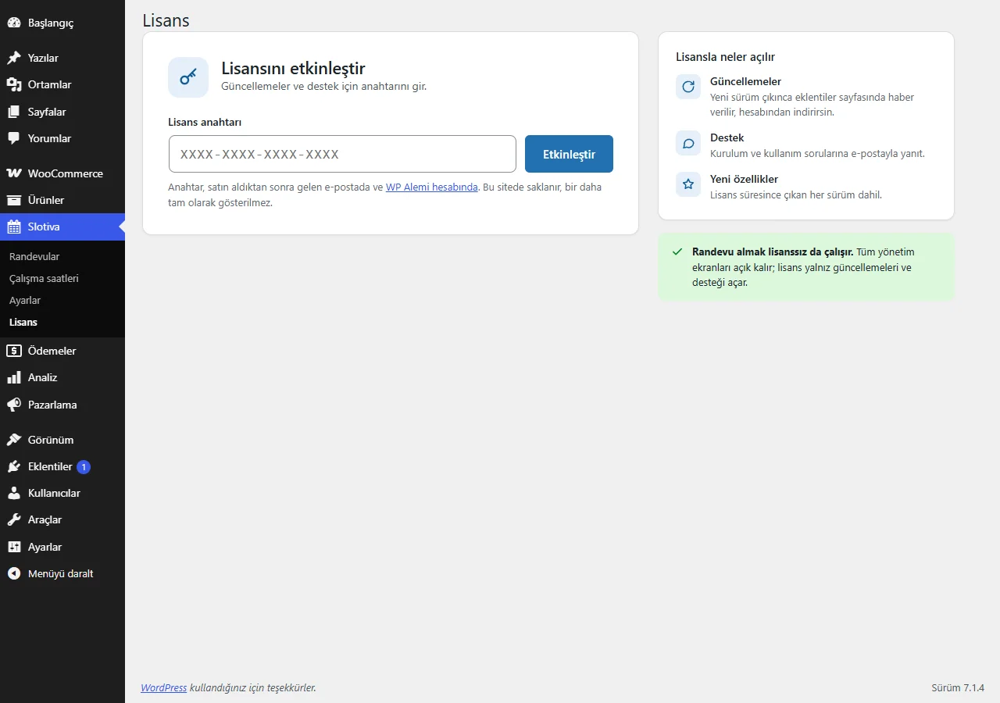
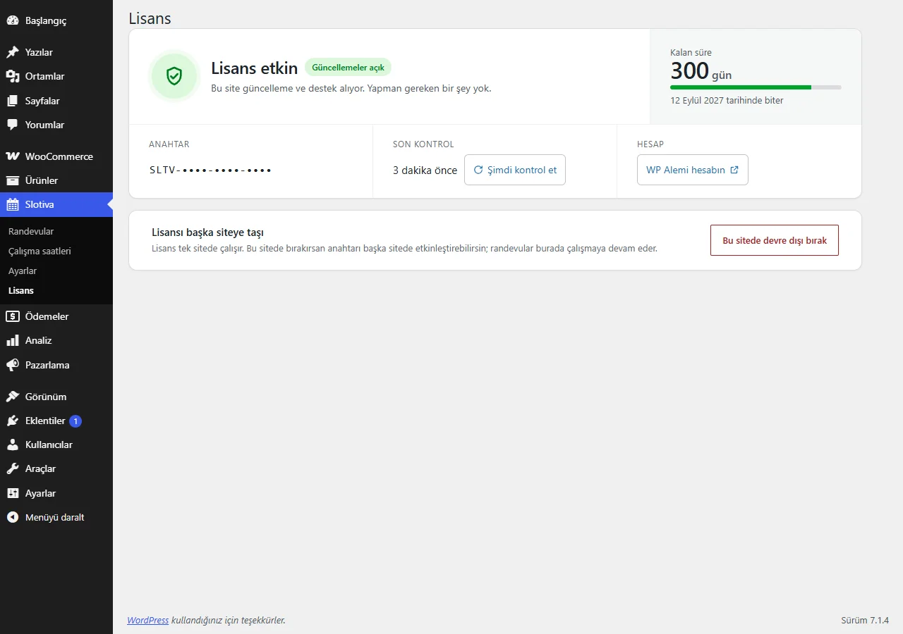
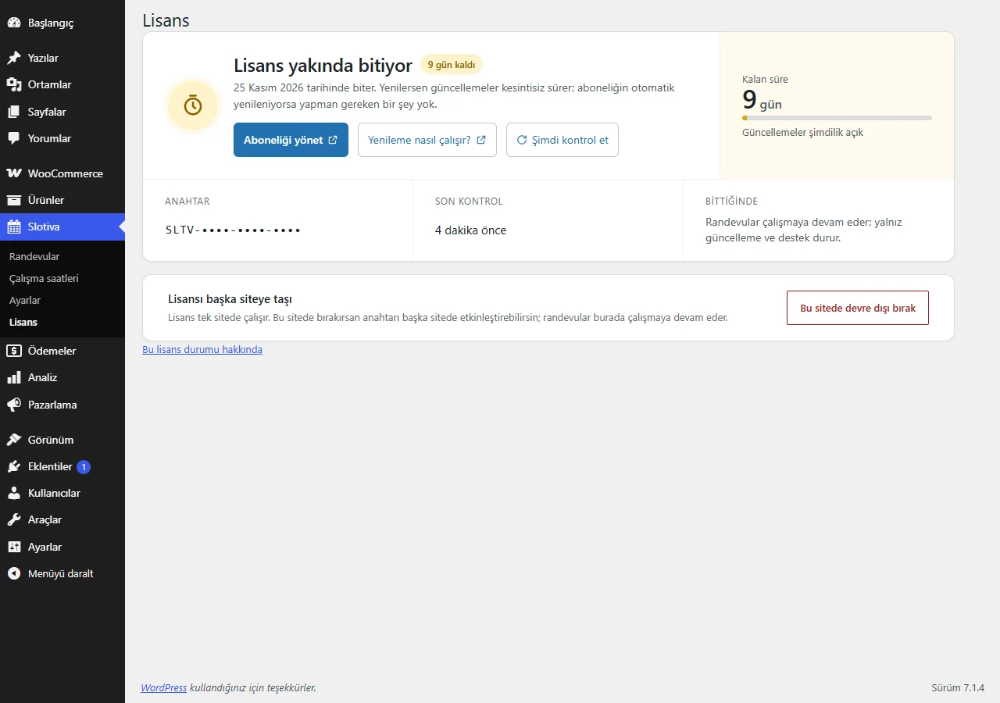
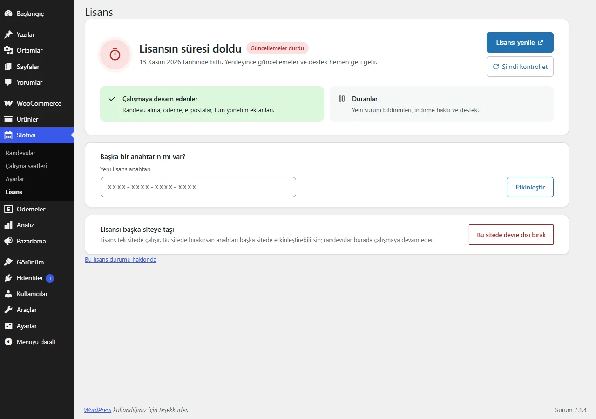
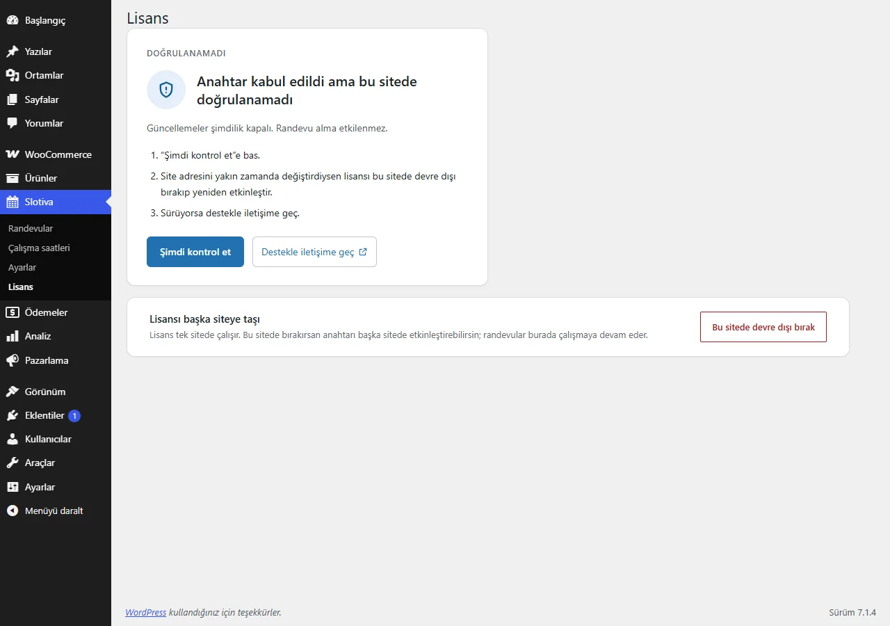
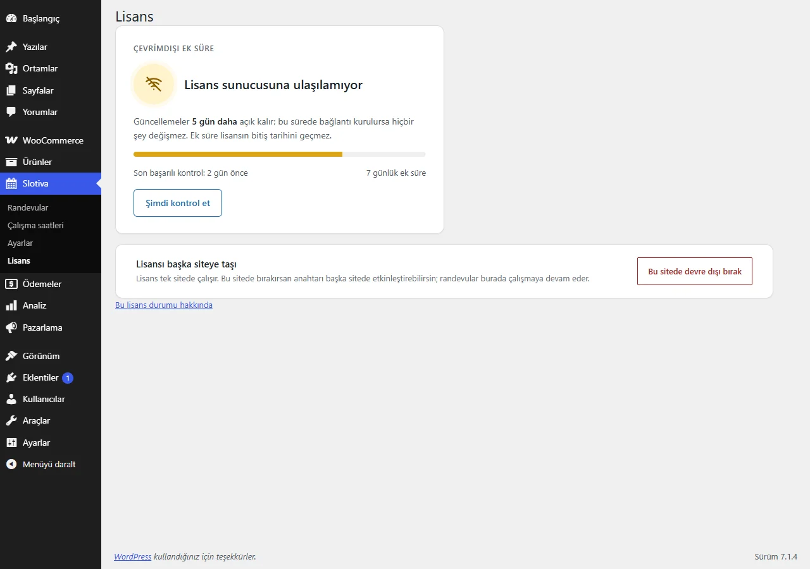

# Lisans ve destek

## Lisansla neler açılır

**Randevu lisanssız da çalışır.** Tüm yönetim ekranları açık kalır; lisans yalnız şunları açar:

- **Güncellemeler** — yeni sürüm çıktığında Eklentiler sayfası haber verir, sen de hesabından indirirsin.
- **Destek** — kurulum ve kullanım sorularına e-postayla yanıt.
- **Yeni özellikler** — lisans süren içinde çıkan her sürüm dahildir.

## Etkinleştirmek

**Slotiva → Lisans**'ı aç, anahtarını yapıştır ve **Etkinleştir**'e tıkla. Anahtar satın alma e-postanda ve
[hesabında](https://wpalemi.com/account/) yazar. Sitende saklanır ve bir daha tam gösterilmez — ekran yalnız ilk 4 karakterini
gösterir.

## Lisans durumları

Lisans ekranı her zaman şu durumlardan birini gösterir.

### Etkin {#active}

Güncellemeler ve destek açık. Ekran kalan gün sayısını, bitiş tarihini, lisansın en son ne zaman kontrol edildiğini (**Şimdi
kontrol et** yeniden kontrol eder) ve hesabına bir bağlantıyı gösterir.

### Yakında bitiyor {#expiring}

Lisans 14 gün içinde bitiyor. Güncellemeler ve destek sürüyor; yenilersen kesintisiz devam eder — aboneliğin kendiliğinden
yenileniyorsa yapman gereken bir şey yok. **Aboneliği yönet** hesabını açar.

### Süresi doldu {#expired}

Bitiş tarihi geçti. **Çalışmaya devam edenler:** randevu alma, ödeme, e-postalar ve tüm yönetim ekranları. **Duranlar:** yeni sürüm
bildirimleri, indirme hakkı ve destek. **Lisansı yenile** hesabını açar; yenileyince güncellemeler ve destek hemen geri gelir.
Başka bir anahtarın varsa **Başka bir anahtarın mı var?** altına gir.

### Bu sitede doğrulanamadı {#unverified}

Anahtar kabul edildi ama bu sitede doğrulanamadı. Güncellemeler şimdilik kapalı; randevu alma etkilenmez. **Şimdi kontrol et**'e
bas. Site adresini yakın zamanda değiştirdiysen lisansı bu sitede devre dışı bırakıp yeniden etkinleştir. Sürüyorsa destekle
iletişime geç.

### Lisans sunucusuna ulaşılamıyor {#offline}

Slotiva lisans sunucusuna ulaşamadı. Güncellemeler son başarılı kontrolden sonra **7 güne kadar** açık kalır; bağlantı bu sürede
geri gelirse hiçbir şey değişmez. Bu ek süre hiçbir zaman lisansın bitiş tarihini aşmaz. **Şimdi kontrol et** yeniden dener.

## Lisansı başka siteye taşımak

Lisans tek sitede çalışır. Lisansı bırakmak için **Bu sitede devre dışı bırak**'a tıkla (her durumda görünür); sonra anahtarı başka
bir sitede etkinleştirebilirsin. Eski sitede randevu alma çalışmaya devam eder.

## Yardım almak

Destek soruları [wpalemi.com](https://wpalemi.com/account/) hesabın üzerinden gelir. Lütfen Slotiva sürümünü (Eklentiler
ekranında yazar) ve sorun çıktığında ne yaptığını da yaz.
