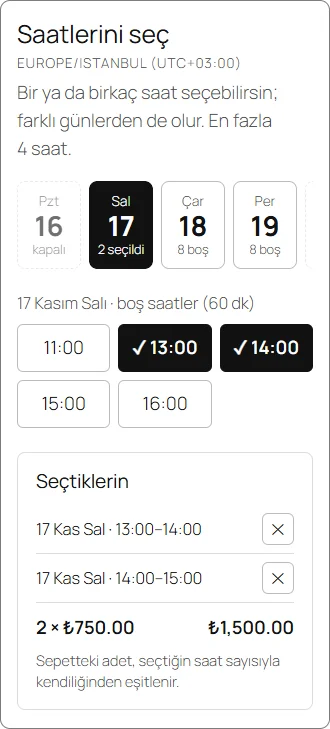

# MHM Slotiva nedir?

MHM Slotiva, bir WooCommerce ürününü **saatlik satılan bir hizmete** çevirir: danışmanlık, özel ders, terapi seansı, koçluk
görüşmesi. Müşterin günü ve bir ya da birkaç saati **doğrudan WooCommerce ödeme sayfasında** seçer ve siparişi tek adımda öder.
Ödeme tamamlanana kadar saat onun için tutulur; böylece iki müşteri aynı saati asla alamaz.

## Bir randevu nasıl ilerler

1. **Müşteri hizmetini sepete ekler** ve ödeme sayfasına geçer.
2. **Ödeme sayfasında günü ve bir ya da birkaç saati seçer.** Saatler farklı günlerde olabilir. Saat başına fiyatlamada sepetteki
   adet, seçilen saat sayısına kendiliğinden eşitlenir.
3. **Siparişi verir.** Slotiva, ödeme tamamlanırken seçilen saatleri tutar:
   - **Kartla ödeme:** saat, kart ödemesi süresince tutulur (varsayılan 45 dakika).
   - **Havale:** saat, havale son tarihine kadar tutulur (varsayılan 24 saat). Ödeme gelmezse sipariş iptal edilir ve saat yeniden
     açılır.
   - **İşletmede ödeme** ve ücretsiz siparişler: randevu hemen onaylanır.
4. **Randevu onaylanır** ve müşteriye takvim dosyalı bir e-posta gider. Randevularını sipariş sayfasında ve *Hesabım* bölümünde de
   görür.
5. **Sen WordPress içinden yönetirsin:** Slotiva → Randevular bugünkü, yaklaşan, geçmiş ve iptal edilmiş randevuları gösterir.
   Saati değiştirebilir, iptal edebilir ya da elle randevu ekleyebilirsin.

## Kimler için

Zaman satan herkes için: danışmanlar, öğretmenler ve eğitmenler, klinikler ve terapistler, koçlar. Bir mağazada birden fazla
randevulu ürün olabilir; her birinin kendi süresi, fiyatı ve bir siparişte alınabilecek saat sayısı vardır.

## (Henüz) yapmadıkları

- Randevu için personel (doktor, öğretmen) seçimi.
- Kapasite: aynı saatte birden fazla müşteri (grup dersleri).

## Sonraki adımlar

- [Slotiva'yı kur](./01-getting-started/installation.md) ve gereksinimleri kontrol et.
- [Kurulum sihirbazını çalıştır](./01-getting-started/setup-wizard.md) — birkaç dakika sürer.
